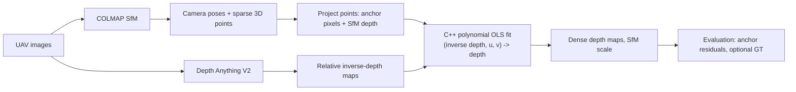

# UAV Depth Densification

[](https://github.com/bigalex95/uav-depth-densification/actions/workflows/ci.yml)
[](LICENSE)


Dense depth maps from posed UAV images: sparse 3D points from COLMAP SfM are used as anchors to fit a per-image polynomial that maps Depth Anything V2 relative inverse depth to depth in the scale of the SfM reconstruction. The scale fit (ordinary least squares, QR-based) is implemented in C++ with Eigen and covered by unit tests.

<!-- TODO: demo image - side-by-side RGB / relative depth / densified depth on a public UAV image set -->

## Highlights

- End-to-end pipeline: COLMAP SfM, monocular depth (Hugging Face `transformers`), C++ densifier, evaluation and visualization tools.
- Per-image least-squares fit of a polynomial in (relative inverse depth, normalised u, normalised v), degree 1 to 3 (4, 10 or 20 features). Pixel coordinates are normalised to approximately [-1, 1] (exact when the principal point is at the image centre); the raw relative inverse depth is used unnormalised. The system is solved with `Eigen::ColPivHouseholderQR` (rank-deficient or under-determined fits are rejected).
- Works on multi-camera rigs: per-camera intrinsics can be supplied via a `cameras.json` and are written into the COLMAP database.
- 12 GoogleTest unit tests for the polynomial features, the fit and the residual statistics. CI builds with `-Werror` and runs them.
- A LaTeX report with the OLS derivation and numerical-stability notes: [docs/report.pdf](docs/report.pdf) (source: [docs/report.tex](docs/report.tex)).

## How it works



1. `scripts/run_sfm.sh` runs COLMAP (SIFT, exhaustive / sequential / spatial / vocab-tree matching, incremental mapper) and exports TXT. `scripts/convert_colmap.py` turns it into `reconstruction.json` (per-image `R`, `t`, `K`, plus the sparse points).
2. `scripts/run_depth.py` runs Depth Anything V2 and stores the raw predicted relative inverse depth (disparity-like, not normalised) as 32-bit float TIFFs.
3. `build/densify_main` projects the sparse points into each image, samples the relative inverse depth at those pixels, fits the polynomial and evaluates it on every pixel. It writes one TIFF per image plus `densification_summary.json`.

## Results

One reference run on a private 90-image UAV survey set (multi-view survey with nadir and oblique views), polynomial degree 2:

| SfM matching | Registered images | Camera models | Avg MAE | Avg RMSE |
| ------------ | ----------------- | ------------- | ------- | -------- |
| Sequential (run 1) | 18 / 90 | 1 | 0.005 m | 0.007 m |
| Sequential (run 2) | 17 / 90 | 1 | 0.011 m | 0.015 m |
| Exhaustive | 90 / 90 | 2 | 0.19 m | 0.35 m |

Per-camera numbers for the exhaustive run are in [docs/report.pdf](docs/report.pdf) (per-camera-group average MAE ranged from 0.077 m to 0.50 m, highest for the nadir view).

How to read these numbers:

- MAE/RMSE are computed at the SfM anchor points that were also used to fit the polynomial (in-sample). They show how well the model reproduces its anchors, not accuracy against independent ground truth. The sequential rows are averages over only the 17-18 registered images and are not comparable to the exhaustive row.
- Depth is in the units of the SfM reconstruction. Without GPS, ground control points or a known baseline, COLMAP's scale is arbitrary, so "m" is only meaningful if the reconstruction is metrically scaled.
- The image set is not included and the numbers were not re-measured for this repository. Only the unit tests and a build were run when the repository was prepared.
- `tools/evaluate_gt.py` can evaluate against the public ETH3D ground-truth depth (see below); no ETH3D results are committed.

## Getting started

### Prerequisites

Ubuntu 22.04 or similar, Python 3.11-3.12 with [uv](https://docs.astral.sh/uv/), COLMAP, CMake >= 3.22, a C++17 compiler, Eigen3, nlohmann-json, GoogleTest, libtiff. A CUDA GPU is optional (depth inference falls back to CPU; COLMAP SIFT falls back to CPU).

```bash
bash scripts/install_deps.sh   # apt / pacman / dnf; installs the system packages above and uv
uv sync                        # Python dependencies (torch, transformers, opencv, ...)
bash scripts/build.sh          # builds build/densify_main and build/depth_densifier_test
```

`bash tools/setup.sh` runs these three steps in one go.

### Bring your own images

No dataset is bundled and no download script is provided. Use your own nadir / oblique UAV image set, laid out as:

```
data/
  images/
    <camera>/*.JPG        # one sub-folder per camera (a flat images/ folder works with cameras.json only if the key is `default`)
  cameras.json            # optional per-camera intrinsics
```

`cameras.json` (optional) maps the camera folder name to its pinhole intrinsics, which are written into the COLMAP database as `SIMPLE_PINHOLE` (the values below are an illustrative example, not a real calibration):

```json
{ "nadir": { "focalLength": 3200.0, "principalPointX": 2000.0, "principalPointY": 1500.0, "width": 4000, "height": 3000 } }
```

Without it, COLMAP estimates intrinsics itself. Public aerial image sets you can try (not tested with this repository): the [OpenDroneMap dataset list](https://opendronemap.org/odm/datasets/).

### Run

```bash
# 1. SfM (COLMAP); exhaustive matching is the default
bash scripts/run_sfm.sh --num_threads 8 --matching_type exhaustive
uv run python scripts/convert_colmap.py           # -> sfm_output/reconstruction.json

# 2. Relative inverse depth (default model: depth-anything/Depth-Anything-V2-Large-hf)
uv run python scripts/run_depth.py --data-dir data/images --output-dir depth_maps

# 3. Densification
./build/densify_main --recon sfm_output/reconstruction.json \
  --depth-dir depth_maps --output-dir densified --degree 2
```

Output: `densified/<camera>/<image>.tif` (32-bit float depth) and `densified/densification_summary.json` (per-image anchor count, MAE, RMSE, max error, plus averages). More SfM options: [docs/SFM_CONFIGURATION.md](docs/SFM_CONFIGURATION.md).

### Tests

```bash
cmake -S . -B build -DCMAKE_BUILD_TYPE=Release -DDD_WERROR=ON
cmake --build build -j
ctest --test-dir build --output-on-failure   # 12 tests
```

The tests cover feature counts for degrees 1-3, the bias term, design-matrix shape, a linear fit-and-densify round trip, rejection of under-determined and rank-deficient fits, the not-fitted state, and MAE/RMSE/quality-threshold behaviour.

### Optional tools

```bash
uv run python tools/visualize_results.py all --recon sfm_output/reconstruction.json \
  --data-dir data/images --depth-dir densified --output visualize_output   # depth / overlay / pointcloud views
uv run python tools/evaluate_gt.py --densified-dir densified --gt-dir <gt_depth_dir> --align
```

`tools/evaluate_gt.py` and `tools/convert_gt_visual.py` read raw float32 ground-truth depth in the [ETH3D](https://www.eth3d.net/datasets) format; `tools/extract_eth3d.sh` unpacks the archives of its "terrains" rig scene. These tools were carried over unchanged and were not re-run for this repository.

## Project structure

```
.
├── CMakeLists.txt
├── pyproject.toml, uv.lock       # Python dependencies (uv)
├── src/
│   ├── depth_densifier.hpp/.cpp  # PolynomialTransformer, DepthDensifier, ResidualAnalyzer
│   └── densify_main.cpp          # CLI: reconstruction JSON + depth TIFFs -> densified TIFFs
├── tests/
│   └── depth_densifier_test.cpp  # 12 GoogleTest cases
├── scripts/                      # pipeline: install_deps, build, run_sfm, update_camera_db,
│                                 #   convert_colmap, run_depth
├── tools/                        # visualization, ETH3D ground-truth evaluation, setup
├── docs/
│   ├── report.tex / report.pdf   # method and numerical-stability report
│   └── SFM_CONFIGURATION.md      # COLMAP matching options
└── .github/workflows/ci.yml      # C++ build + ctest, Python/shell syntax check
```

## Limitations

- One global polynomial per image: it cannot model spatially varying scale; high degrees can oscillate where anchors are sparse (degree 2 is the default, degree 3 is untested here).
- Plain OLS: no outlier rejection. SfM outliers feed directly into the fit. Robust fitting (IRLS / Huber) is discussed in the report but not implemented.
- Error numbers are in-sample and in SfM units (see Results). A held-out anchor split or an independent ground-truth evaluation is not part of the committed results.
- Depth Anything V2 output is a relative inverse depth (disparity-like) prediction; the polynomial regresses depth on it directly (a polynomial approximation of the inverse relation) and treats it as a fixed input and does not use image content beyond that.
- Only the C++ library has automated tests; the Python scripts are checked for syntax only. The full pipeline was not re-run on a public dataset for this repository.
- Whole-image densification is single-threaded C++ and builds a feature vector per pixel, so large images are slow (not benchmarked).

## Credits

- [COLMAP](https://github.com/colmap/colmap) (Schonberger and Frahm, "Structure-from-Motion Revisited", CVPR 2016), BSD-licensed; used as an external tool for SfM.
- [Depth Anything V2](https://github.com/DepthAnything/Depth-Anything-V2) (Yang et al., [arXiv:2406.09414](https://arxiv.org/abs/2406.09414)), used through Hugging Face `transformers`. License note: the Small checkpoint is Apache-2.0, while the Base and Large checkpoints (the default here is Large) are CC-BY-NC-4.0, i.e. non-commercial. Check the model card before commercial use.
- [ETH3D](https://www.eth3d.net/datasets) data format, for the optional ground-truth tools.
- Eigen, nlohmann-json, GoogleTest, libtiff, PyTorch, OpenCV, Open3D.

## License

MIT, see [LICENSE](LICENSE). Third-party tools and model weights keep their own licenses.
